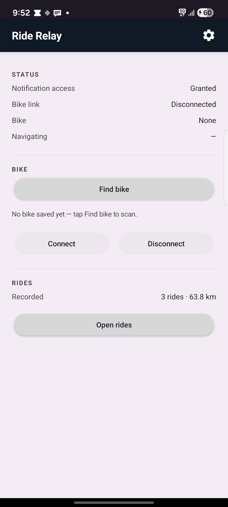
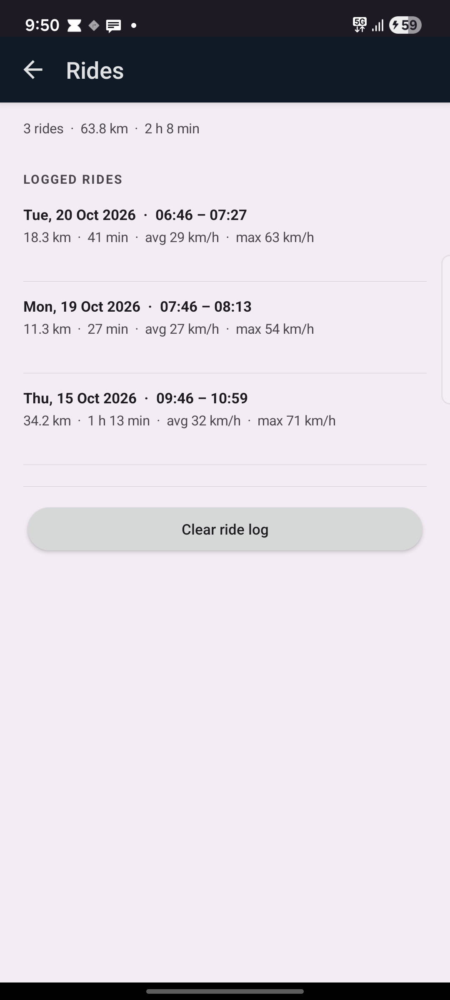
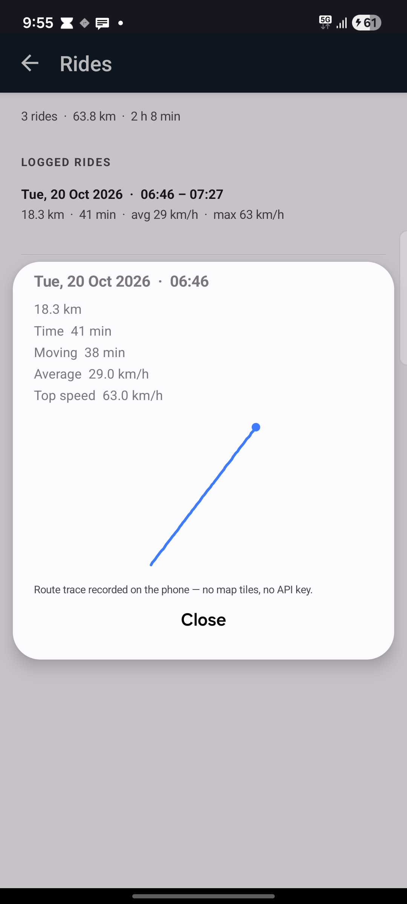

# Ride Relay

**Google Maps turn-by-turn navigation on a Bajaj / Pulsar instrument cluster, from an
ordinary unrooted Android phone.**



The official *Bajaj Ride Connect* app only shows directions inside its own UI, and its
map provider (Mappls / MapmyIndia) is what feeds the cluster. This is a small standalone
companion that takes over the BLE link itself and speaks the cluster's own display
protocol, with **Google Maps** as the source of directions.

It also shows who is calling, counts missed calls, and keeps its own ride log because the
official trips live in Bajaj's cloud, not on the bike.

No root. No patched APK, no Google Maps API key. Just a normal app you install.

**Current release: [v1.7](RELEASE-v1.7.md)** — NFC tags now connect without opening the
app, and Advanced can check GitHub for updates (once a day, or on demand).

<br clear="right">

---

## How it works

```
Google Maps navigation notification              dialer notifications
        │  NotificationListenerService          │  same listener
        ▼                                       ▼
   NavParser ──┬─► ManeuverMatcher        PhoneBridge ──► caller name, call state
        │      │      shape-matched              │
        │      └─► fallback: keywords            ▼
        ▼                                 0310676e (missed call)
    NavState  ──►  RelayService, every 800 ms
                        │
                        ▼
              48-byte turn-by-turn frame
                        │
                ┌───────┴────────┐
                ▼                ▼
        0110676e-… (TBT)   0210676e-… (general status)
        turn arrows        call state + counts, 55-byte legacy / 89-byte v2
                                 ▲
                        0a10676e (control) read every 700 ms:
                        accept / decline, volume, media keys
```

The interesting problem: Google Maps' navigation notification does **not** contain the
maneuver. It publishes the distance, an arrival clock, and a road name — the direction
exists only as an icon. Older Maps text said `Turn left onto MG Road`, but the current
build says `towards MG Road` and puts the arrow purely in the bitmap.

So the app renders Google Maps' *named* maneuver drawables
(`maneuver_turn_normal_left`, `maneuver_roundabout_enter_and_exit_cw_sharp_right`, …)
by loading them out of the Maps package at runtime, and shape-matches them against the
notification icon. Both images are cropped to their foreground bounding box and reduced
to a small boolean grid, which makes the comparison immune to size, padding and tint
differences. Typical confidence on a real turn is 97–98 %.

Full protocol notes, frame layouts and field-by-field findings: **[`docs/PROTOCOL.md`](docs/PROTOCOL.md)**.

## Requirements

| | |
|---|---|
| Phone | Android 7.0+ (API 24), Bluetooth LE |
| Bike | Bajaj / Pulsar with a smart-connected cluster that the official *Bajaj Ride Connect* app drives |
| Navigation source | Google Maps (free, normal consumer app) |
| Network | Only the optional update check (GitHub); can be switched off |
| Root | Not required |

Confirmed on real bikes: **Pulsar NS200** (2023, 2026 cluster firmware), **Pulsar NS400Z**
and **Pulsar N160UG**. If the official app can show navigation on your cluster, Ride Relay
has a good chance of working there too.

## Install

Grab the APK from [Releases](../../releases) and open it on the phone, or build it
yourself (see [Building](#building)).

```sh
adb install -r ride-relay.apk
```

Updating from v1.6? Install v1.7 over the top: the signing key is the same, so settings,
the saved bike and the ride log are kept. From v1.7 on, later releases can be installed
from **Advanced → Updates** instead of downloading by hand.

### Play Protect will warn you — here's why

The app is signed with a self-signed key and is not distributed through Google Play, so
Play Protect has no reputation data for it and shows *"unsafe app blocked"* or *"can't
verify this app"*. It gets extra scrutiny because it asks for notification access — the
permission malware uses to read other apps' notifications. Nothing is being flagged; the
app simply has no Play identity.

Tap **More details → Install anyway**. If the install is blocked outright, turn off
*Play Store → profile → Play Protect → Scan apps with Play Protect* while you install, then
turn it back on. On Samsung, also make sure **Auto Blocker** is off
(Settings → Security and privacy → Auto Blocker). `adb install` bypasses this gate entirely.

## First run

1. Open the app and tap **Enable notification access** → allow **Ride Relay**.
   (This is how it reads Google Maps' navigation notification.) The button only appears
   while access is missing.
2. Grant the Bluetooth permissions when prompted.
3. **Force-stop the official *Bajaj Ride Connect* app** (Settings → Apps → Force stop).
   The cluster accepts only one phone connection at a time.
4. Tap **Find bike** and pick your bike from the list.
5. Wait for **Bike link: Ready**.

After the first connect the bike is remembered, so the app reconnects on its own.

## Using it

- Start navigation in Google Maps. The cluster shows the arrows, distance and ETA.
- The main screen is just the status and the bike controls: **Find bike**, **Connect**,
  **Disconnect**, plus **Open rides**.
- Tap the **gear** in the top right for **Advanced**: a relay on/off switch, the general
  status packet mode, the phone switches (calls, ride log), NFC connect, test frames (so
  you can prove the BLE link works without Maps), and a log with **Copy log**.

The **Status** panel shows the live state: notification access, link state, connected
bike, and what is currently being sent to the cluster.

### Calls

With **Calls on the cluster** enabled, an incoming call shows the contact name on the
cluster (or the number when the phone has no name). Missed calls are counted and can be
listed from the cluster. Messages are not mirrored — only calls.

The app asks for the call permissions once. Notification access (step 1 above) is what
lets it see the dialer at all — no call-log or contacts permission is used.

### Rides

The official app's trip history comes from Bajaj's cloud, not the bike, so Ride Relay
records its own: while the bike link is up it samples GPS every 5 s and saves distance,
time, average and top speed when the ride ends. **Open rides** lists them, and tapping a
ride shows the numbers plus a trace of the route. The trace is drawn from the recorded
points — no map tiles, no Maps SDK key.

A ride ends when the link drops, and also after ten minutes without movement so a bike
parked with the ignition on does not become one long trip. Nothing is uploaded; the log
lives in the app's own database and **Clear ride log** deletes it.

Requires location permission ("while using the app" is enough — the foreground service
keeps sampling with the screen off). Without it, everything else still works; there is
just no ride log.

### NFC tag (optional)

Advanced → **Connect with NFC** shows the URL `bajajrelay://connect`. Write it to any NFC
tag as a URI record (NFC Tools, TagWriter), stick the tag on the bike, and tapping it with
the screen on connects to the saved bike. Ride Relay does not open: a transparent,
animation-free activity starts the foreground service, connects and finishes immediately.
Android only dispatches NFC tags to activities, so this is as close to a background
"connect only" trigger as a normal app can get. The switch turns the trigger off; the app
never reads tag contents beyond that one URL.

### Updates

Advanced → **Updates** shows the installed version and a **Check for updates** button. The
app also checks GitHub Releases at most once a day when it is opened; the checkbox turns
that off.

When a newer release exists, the button changes to **Download and install**. The APK is
downloaded over HTTPS, checked against the SHA-256 GitHub publishes for the release asset,
and handed to the system installer. Android still asks for confirmation, and the first
time you will have to allow *Install unknown apps* for Ride Relay. Nothing is installed
silently. The updater is the only code that touches the network; rides, calls and the log
never leave the phone.



Tapping a ride opens the numbers and the trace:



The app reconnects on its own whenever the bike is in range. If it cannot reach the bike
for about four minutes it stops trying and shows **Bike link: Idle — tap Connect**, so a
parked or switched-off bike doesn't cost a connection attempt every 15 s. Tap **Connect**
to start again.

## Troubleshooting

| Symptom | Cause / fix |
|---|---|
| Link keeps dropping every 20–60 s | The phone is at the edge of BLE range of the bike. The app reconnects on its own within ~3 s. |
| **Bike link: Idle — tap Connect** | Auto-reconnect gave up after ~4 min of failures — the bike is off or out of range. Tap *Connect* to start retrying again. |
| **Bike link: Disconnected** right after *Find bike* | The official app is probably still connected. Force-stop it, then tap *Connect*. |
| Arrows appear but the wrong way round | Open **Advanced** (gear, top right), send a **Left** test frame, and check. Then attach the `maps.nav ->` log lines to an issue. |
| Nothing appears on the cluster at all | Try the other **General status packet** modes (Legacy 55 / V2 89 / Off). Test frames in **Advanced** should still work; if they don't, it's the BLE link, not the parser. |
| No arrow when navigating, but test frames work | Check `Status → Notification access` is *Granted* and that you are navigating in **Google Maps**. |
| Calls never show on the cluster | Advanced → **Calls on the cluster** must be on and the phone-state / answer-call permissions granted. The log should show `call watch on` and `call state -> incoming`. |
| Rides list stays empty | **Record rides** is off, location permission was denied, or the ride was under 200 m / 60 s — those are discarded as noise. The main screen shows `recording` while a ride is being tracked. |
| Cluster keys do nothing | The cluster's control characteristic is polled; if the bike's firmware doesn't expose it, only the display side works. The log shows `control bootstrap` the first time a read succeeds. |

## Building

No Gradle. The app builds directly against the Android command-line SDK
(`aapt2` + `javac` + `d8` + `zipalign` + `apksigner`), which needs no network and no
project scaffolding.

```sh
cd app
./build.sh          # -> app/out/ride-relay.apk
```

Requirements: JDK 17+ and Android SDK build-tools 35 + `platforms/android-34`.
Set `ANDROID_HOME` if the SDK is not at the default path. The signing key
`relay.jks` is generated on first build if missing (alias `relay`, password `android`)
— **replace it with your own for anything you publish**, and never commit it.

Note: build-tools **35** is required. The `d8` in 34 crashes on classes with nested or
anonymous classes.

## Repository layout

| Path | What |
|---|---|
| `app/` | The Android app: Java sources, resources, and the build script. |
| `docs/` | Protocol findings and screenshots. |
| `re-work/` | Local reverse-engineering scratch (decompiled dumps, extracted APKs). **Not committed** — see [Legal](#legal). |

## Legal

This is an interoperability project. It talks to a device you own using a protocol
observed on the wire, and it reads a notification Google Maps already publishes to a
service you explicitly enable.

- Not affiliated with, endorsed by, or supported by Bajaj Auto, Google, or MapmyIndia.
- It ships no code or assets from the official app or from Google Maps. The maneuver
  icons are read from the installed Google Maps at runtime on your own device; nothing
  is copied into this repository.
- Do not commit or redistribute the official APKs or their decompiled output. The
  `.gitignore` excludes them.
- Use at your own risk. Writing to an instrument cluster is not risk-free; no warranty.

Google Maps notification internals are undocumented and change between releases. The
text-keyword fallback keeps things working if the icon resources ever move.

## License

[MIT](LICENSE).
